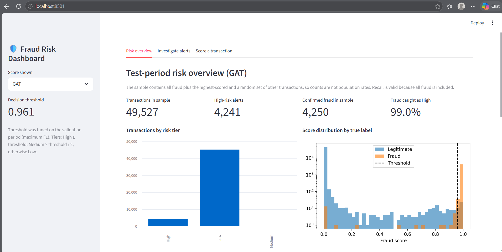
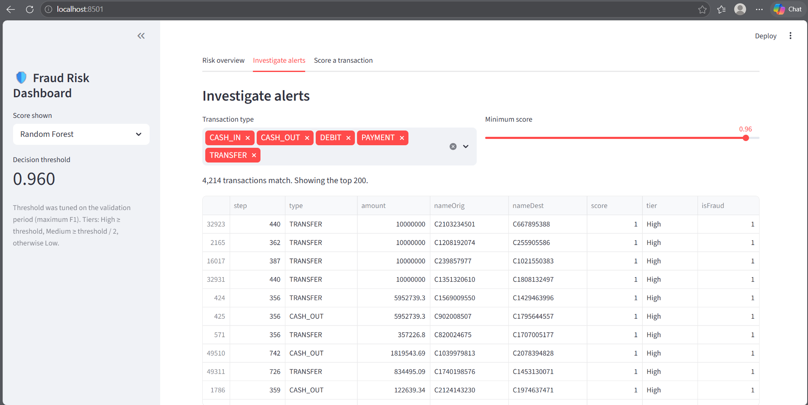
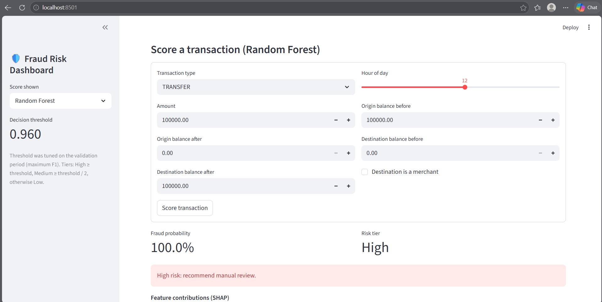

# Explainable Financial Fraud Detection using Graph Neural Networks

An explainable fraud detection system that compares traditional machine learning with Graph Neural Networks (GCN and GAT) to identify suspicious financial transactions. The project combines graph-based learning, SHAP explanations, and an interactive Streamlit dashboard to support fraud risk analysis and investigation.

## 1. Project Overview

Financial fraud detection is challenging because fraudulent transactions represent a very small proportion of total transactions and may involve relationships between multiple accounts. Traditional transaction-level models can identify suspicious patterns in individual transactions, but they may not fully capture relationships between accounts.

This project explores whether representing financial transactions as a graph can improve fraud detection. It compares a Random Forest baseline with two Graph Neural Network models—Graph Convolutional Network (GCN) and Graph Attention Network (GAT).

The system also uses SHAP (SHapley Additive exPlanations) to interpret model predictions and a Streamlit dashboard to visualize fraud risk and investigate suspicious transactions.

**Dataset:** PaySim synthetic mobile-money transaction dataset, containing approximately 6.36 million transactions.

## 2. Problem Statement

Financial institutions need reliable ways to identify fraudulent transactions while minimizing false alerts. Fraud detection is particularly difficult because of severe class imbalance, changing transaction patterns, and the limited interpretability of complex machine learning models.

The objective is to develop and evaluate an explainable fraud detection pipeline that compares transaction-level and graph-based approaches, measures their performance using fraud-focused metrics, and provides interpretable outputs for risk monitoring.

## 3. Project Objectives

- Explore transaction patterns and identify characteristics associated with fraudulent activity.
- Engineer transaction-level features and distinguish features available before a transaction from those observed afterward.
- Represent accounts as graph nodes and transactions as directed edges.
- Train and compare Random Forest, GCN, and GAT models.
- Evaluate models using PR-AUC, precision, recall, F1-score, and alert-ranking measures.
- Use SHAP to explain feature contributions and individual fraud predictions.
- Build an interactive Streamlit dashboard for fraud risk monitoring and transaction investigation.

## 4. Methodology

The project follows these stages:

1. **Data loading and exploration:** Examine the PaySim dataset, transaction types, class imbalance, and fraud patterns.
2. **Feature engineering:** Prepare transaction features and distinguish pre-transaction information from post-transaction balance information.
3. **Graph construction:** Represent accounts as nodes and transactions as directed edges, using transaction windows to build graph snapshots.
4. **Model development:** Train Random Forest baselines alongside GCN and GAT graph models.
5. **Model evaluation:** Use chronological training, validation, and test splits. Select decision thresholds on the validation set and evaluate the models on the held-out test set.
6. **Explainability:** Apply SHAP to understand the contributions of transaction features and account-level graph embeddings to predictions.
7. **Dashboard development:** Present risk summaries, suspicious transactions, explanations, and transaction-scoring functionality in Streamlit.

## 5. Tech Stack

| Technology | Purpose |
|---|---|
| Python | Core programming language |
| Pandas and NumPy | Data manipulation and numerical computation |
| Scikit-learn | Random Forest, preprocessing, and evaluation |
| PyTorch | Deep learning |
| PyTorch Geometric | Graph Neural Network implementation |
| NetworkX | Graph construction and visualization |
| SHAP | Model explainability |
| Matplotlib | Data visualization |
| Joblib | Saving and loading model artifacts |
| Streamlit | Interactive fraud detection dashboard |
| Jupyter Notebook | Experimentation and model development |

## 6. Model Evaluation and Results

The project compares three model families:

- **Random Forest (RF):** A transaction-level baseline trained with all selected features, with a separate version restricted to pre-transaction features.
- **Graph Convolutional Network (GCN):** Learns account representations by aggregating information from connected nodes.
- **Graph Attention Network (GAT):** Uses attention mechanisms to learn the importance of information from neighboring accounts.

### Evaluation strategy

- Split the transactions chronologically into training, validation, and test periods.
- Use PR-AUC (Precision–Recall Area Under the Curve) as a key metric because fraud is rare.
- Tune the decision threshold on the validation set using F1-score.
- Apply the selected threshold unchanged to the test set.
- Examine precision, recall, F1-score, and the quality of ranked fraud alerts.

### Recorded results

The notebook reports the following test PR-AUC values:

| Model | Test PR-AUC |
|---|---:|
| Random Forest — all features | 1.0000 |
| GAT | 0.9967 |

The notebook's comparison identifies Random Forest with all features as the best model by validation PR-AUC. The best graph model, GAT, achieves a test PR-AUC of 0.9967, compared with 1.0000 for the Random Forest baseline.

**Interpretation:** In these experiments, graph-based learning did not outperform the strongest transaction-level baseline. The near-perfect scores should be interpreted cautiously because PaySim is synthetic and contains distinctive fraud patterns. These results do not establish equivalent performance on real-world banking transactions.

## 7. Explainability with SHAP

SHAP is used to explain why a model assigns a particular fraud score.

The project includes:

- **Global explanations:** Identify features that contribute strongly to predictions across transactions.
- **Local explanations:** Examine the factors contributing to an individual transaction's fraud score.
- **Graph-model explanations:** Separate the contribution of transaction features from source-account and destination-account embeddings.

These explanations can help analysts investigate suspicious activity instead of relying only on a model-generated score.

## 8. Streamlit Dashboard

The dashboard provides three main views:

1. **Risk Overview**
   - Fraud alert counts by risk tier
   - Fraud-score distribution
   - Alerts by transaction type
   - Model comparison and sample-level recall

2. **Investigate Alerts**
   - Ranked suspicious transactions
   - SHAP explanation for a selected alert
   - Account-neighbourhood graph visualization

3. **Score a Transaction**
   - Enter transaction details
   - Obtain a fraud probability and risk category
   - View a SHAP waterfall explanation

The dashboard's live transaction-scoring interface uses the saved Random Forest model. GCN and GAT scores are displayed for the pre-scored test-period sample because graph-model scoring requires the surrounding transaction graph.

### Dashboard Screenshots

Add screenshots of your actual running dashboard below. Save the images in a folder such as `screenshots/` in the repository.

<!-- Replace these placeholders with your actual screenshots after uploading them. -->

**Risk Overview**

<!--  -->

**Investigate Alerts**

<!--  -->

**Score a Transaction**

<!--  -->

## 9. Installation and Execution

### Prerequisites

- Python 3.10 or another version compatible with the installed dependencies
- Git
- Jupyter Notebook or JupyterLab
- A compatible PyTorch and PyTorch Geometric installation

### Step 1: Clone the repository

```bash
git clone https://github.com/manjiriapshinge25/explainable-financial-fraud-detection.git
cd explainable-financial-fraud-detection
```

### Step 2: Create a virtual environment

```bash
python -m venv .venv
```

Activate it on Windows:

```bash
.venv\Scripts\activate
```

### Step 3: Install dependencies

```bash
python -m pip install --upgrade pip
pip install -r requirements.txt
```

If PyTorch Geometric installation fails, install a compatible PyTorch/PyG combination for your operating system and Python environment.

### Step 4: Prepare the dataset and model artifacts

The raw dataset and generated model artifacts are not included in the repository. Obtain the PaySim dataset from its legitimate source and follow the notebook's data-loading instructions.

Run the notebook cells to preprocess the data, train the models, evaluate their performance, generate SHAP explanations, and save the artifacts required by the dashboard.

The dashboard requires the expected saved model files and scored sample files produced by the notebook. It will not be fully functional until these files have been generated and are available in the expected locations.

### Step 5: Run the notebook

```bash
jupyter notebook 01_fraud_gnn_pipeline.ipynb
```

Run the notebook from top to bottom, following its setup and data-loading instructions.

### Step 6: Launch the dashboard

From the project directory, run:

```bash
streamlit run app.py
```

Open the local URL displayed in the terminal to access the dashboard.

## 10. Repository Structure

```text
explainable-financial-fraud-detection/
│
├── 01_fraud_gnn_pipeline.ipynb
├── app.py
├── fraud_features.py
├── requirements.txt
├── README.md
├── .gitignore
│
├── data/
│   └── README.md
│
├── saved_models/
│   └── README.md
│
└── results/
    └── README.md
```

The `data/`, `saved_models/`, and `results/` directories contain README placeholders explaining the purpose of each location. Raw data and generated artifacts are excluded from version control.

## 11. Limitations

- PaySim is a synthetic dataset; performance may differ substantially on real financial transaction data.
- The dataset contains a highly imbalanced fraud class, so accuracy alone is not a sufficient evaluation metric.
- The graph models did not outperform the strongest Random Forest baseline in the reported comparison.
- SHAP explanations describe model behaviour; they do not establish that a feature causes fraud.
- The dashboard depends on model and sample artifacts generated by the notebook.

## 12. Future Scope

- Evaluate the pipeline on real-world or additional publicly available fraud datasets.
- Investigate graph structures that better capture repeated interactions, connected fraud rings, and mule-account behaviour.
- Explore temporal Graph Neural Networks to model changes in account relationships over time.
- Improve alert prioritization using precision-at-k, recall-at-k, and analyst-oriented evaluation.
- Assess model calibration, robustness, and fairness across relevant transaction groups.
- Deploy the dashboard with secure data access, monitoring, and periodic model updates.

## 13. Key Takeaway

This project demonstrates an end-to-end approach to explainable financial fraud detection by combining transaction-level machine learning, graph-based learning, SHAP explanations, and an interactive dashboard. It also highlights the importance of comparing complex graph models against strong baselines and interpreting synthetic-data results cautiously.

## Author

**Manjiri Apshinge**

M.Sc. Data Science

[GitHub Repository](https://github.com/manjiriapshinge25/explainable-financial-fraud-detection)
